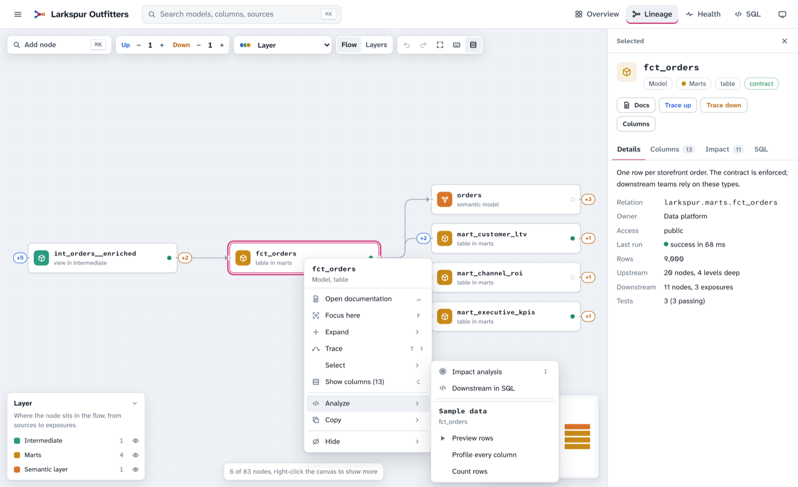
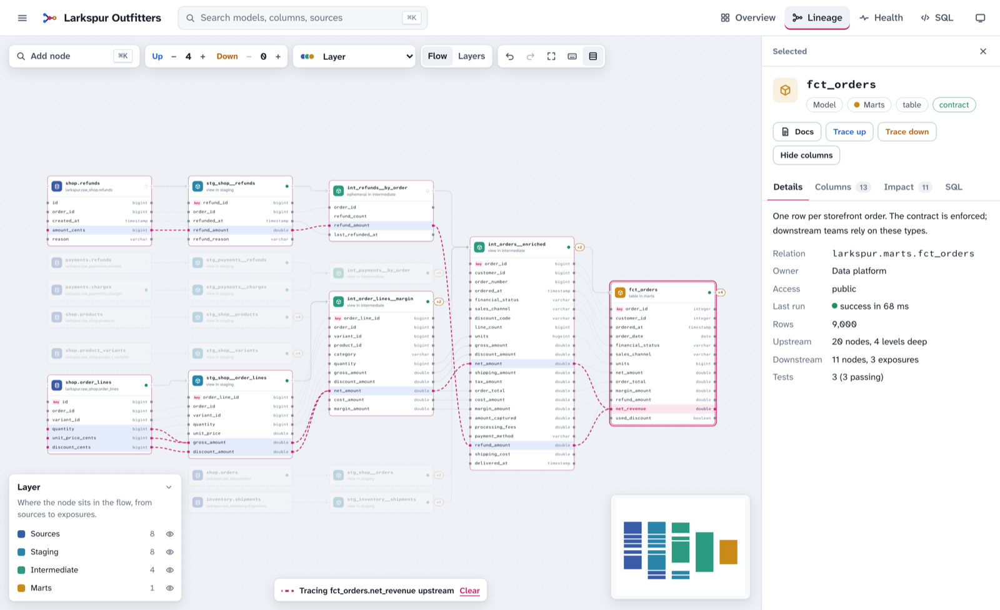
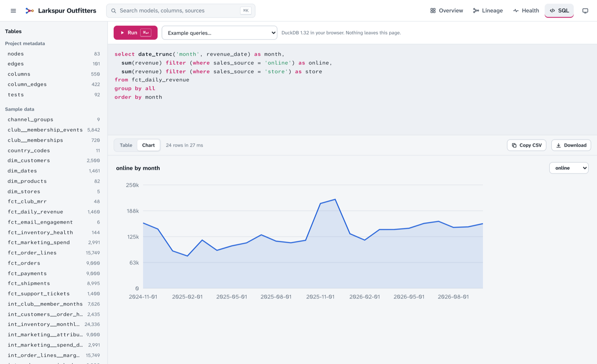

# Lineum

**Lineage-first documentation for dbt projects.** Lineum reads the artifacts dbt writes to `target/` and builds a static site: a lineage explorer you can right-click, column-level lineage parsed from your SQL, impact analysis, and SQL over your project in the browser.

> **Status: 0.1 preview · Apache-2.0 · not on PyPI yet.** Install from GitHub ([install](#install)). Commands, configuration and the site's look may change before 1.0. See [what is not built yet](#what-is-not-built-yet).

[Live demo](https://lineum-demo.vercel.app) · [Website](https://lineum.vercel.app) · [Guides](docs/guides/) · [Changelog](CHANGELOG.md)



The demo documents *Larkspur Outfitters*, a fictional retailer: 49 models, 21 sources, 5 exposures and 422 column edges, built from the example project in [`examples/larkspur`](examples/larkspur).

## What you get

- **A lineage explorer you can drive.** Start from any model and grow the graph one level at a time from the `+N` pills on each node: blue for hidden parents, amber for hidden children. Color nodes by layer, materialization, test status, run time, freshness, blast radius, row count, documentation, owner, folder, package, access or tag. Click a legend entry to select it, or hide it. Trace upstream or downstream and an animated tracer runs along the path. Select two nodes to see every path between them. Undo, redo, and share the view: it lives in the URL.
- **Right-click on everything.** Nodes, columns, the canvas, a selection, the sidebar tree, search results and links all open the same menus: open docs, focus, expand, trace, select upstream or downstream, show columns, analyze, copy `ref()`, a dbt selector, `dbt build --select model+` or the relation name, and hide. Every action has a shortcut or a visible equivalent. Press `?` in the explorer for the list.
- **Column-level lineage.** Lineum parses compiled SQL with [sqlglot](https://github.com/tobymao/sqlglot) and follows every column through CTEs, subqueries, unions and joins. Each edge is labelled *direct*, *renamed*, *derived* or *aggregated*. Ephemeral models are handled. A column whose source cannot be resolved has no edge; Lineum does not guess. Click a column inside a node to trace it.
- **Impact analysis.** See what a change reaches: downstream models by layer, the exposures (dashboards, notebooks, ML models, apps) affected, the owners to tell, and stale sources upstream. In the explorer, in the terminal, or as Markdown for a pull request.
- **SQL in the browser.** The SQL page loads [DuckDB-WASM](https://duckdb.org/docs/api/wasm/overview) on demand and exposes your project as tables: `nodes`, `edges`, `columns`, `column_edges` and `tests`. Exported sample data (optional) becomes one view per model. `{{ ref('fct_orders') }}` works. Results show as a table or a chart and download as CSV. Queries run in your browser; nothing is sent anywhere.
- **Health checks for CI.** A weighted score covers descriptions, column docs, tests, tested primary keys, freshness checks, owners for marts and enforced contracts on public models. Findings point at the models to fix: failing tests, stale sources, sources read outside staging, unused models and more. `lineum check --fail-under 70` fails a build that slips.
- **Real pages, not only an app.** Every model, source, seed, snapshot, exposure and metric gets its own server-rendered HTML page, with its title, description, columns, upstream and downstream links, SQL and schema.org JSON-LD. The site also writes `sitemap.xml`, `robots.txt`, `llms.txt` and `llms-full.txt`. Search engines and AI agents can read it, it works without JavaScript, and it opens straight from disk.



## Install

Python 3.10 or later.

```sh
pipx install "git+https://github.com/zinnoberHaus/lineum"
```

Or run it once without installing:

```sh
uvx --from git+https://github.com/zinnoberHaus/lineum lineum build
```

`pip install lineum` does not work yet: the package is not on PyPI. The web app ships prebuilt inside the Python package, so you do not need Node.

To export sample data from a DuckDB warehouse, add the `data` extra: `pipx install "lineum[data] @ git+https://github.com/zinnoberHaus/lineum"`.

## Quick start

```sh
cd your-dbt-project
dbt docs generate      # writes manifest.json (with compiled SQL) and catalog.json
lineum build           # writes the site to target/lineum
lineum serve           # opens http://127.0.0.1:8000
```

Lineum needs `target/manifest.json`. Column lineage needs compiled SQL, which `dbt docs generate`, `dbt compile`, `dbt run` and `dbt build` write. Lineum also reads, when present, `catalog.json` (column types, row counts), `run_results.json` (run status and timing, test results) and `sources.json` (`dbt source freshness`). If the manifest lacks compiled SQL, Lineum falls back to `run_results.json`, then to `target/compiled/`.

Try it on the example without a dbt installation; its artifacts are committed:

```sh
git clone https://github.com/zinnoberHaus/lineum && cd lineum
lineum build examples/larkspur --out /tmp/larkspur-docs
lineum serve /tmp/larkspur-docs
```

## Commands

| Command | What it does |
| --- | --- |
| `lineum build [PROJECT]` | Generate the site (default output: `target/lineum`). `--out`, `--title`, `--base-url`, `--noindex`, `--no-sql`, `--data FILE.duckdb`, `--data-rows N`, `--head-html FILE`, `--exclude-package NAME`, `--no-column-lineage`. |
| `lineum serve [SITE]` | Preview a built site locally. |
| `lineum dev [PROJECT]` | Build, serve, and rebuild whenever dbt rewrites its artifacts. |
| `lineum check [PROJECT]` | Print the health report. `--fail-under 70` exits with status 1 below the threshold. `--format text\|json\|markdown`. |
| `lineum impact NODE` | Everything downstream of a node, or of one column with `--column`. `--format markdown` is ready to paste into a pull request. |
| `lineum lineage NODE` | Upstream and downstream in the terminal, with `--up`/`--down` depth, `--column`, `--format text\|json\|mermaid`. |
| `lineum export` | The graph as `json`, `mermaid` or `dot`, optionally around `--focus NODE`. |

A node is a model name (`fct_orders`), a unique id (`model.shop.fct_orders`), a source as `source_name.table`, or `type:name` (`exposure:executive_dashboard`).

## Configuration

Every setting has a flag; flags win. Put a `lineum.yml` next to `dbt_project.yml`:

```yaml
title: Larkspur data docs
base_url: https://docs.example.com/     # canonical links and sitemap.xml
exclude_packages: [dbt_project_evaluator]
layers:                                  # how models map to lineage layers
  staging: ["stg_*", "*/staging/*"]
  marts: ["fct_*", "dim_*", "*/marts/*"]
data:
  duckdb: warehouse.duckdb               # optional sample data export
  rows: 5000
queries:                                 # example queries on the SQL page
  - title: Revenue by month
    sql: select date_trunc('month', ordered_at) as month, sum(net_revenue) from fct_orders group by 1
```

See [configuration](docs/guides/configuration.md) for every setting.

## Deploy the site

The output is plain files: host it on GitHub Pages, Netlify, Vercel, S3 and CloudFront, an internal web server, or nowhere (open `index.html`). Set `--base-url` to the public address to get canonical URLs and a sitemap. Use `--noindex` for docs that should stay out of search engines, and `--no-sql` to leave SQL out. [Deploying](docs/guides/deploying.md) has ready-made workflows.

## In CI

```yaml
- run: lineum check --fail-under 70
- run: lineum impact fct_orders --format markdown >> "$GITHUB_STEP_SUMMARY"
```

[CI recipes](docs/guides/ci.md) shows how to comment the impact of a pull request's changed models.



## What is not built yet

- A PyPI release. Install from GitHub until 0.1.0 is published.
- Sample data from warehouses other than DuckDB. The metadata tables work for every adapter.
- dbt v2 (Fusion) Parquet metadata. Run dbt v2 with `--write-catalog` so Lineum gets a `catalog.json`.
- Column lineage for Python models and for SQL that sqlglot cannot parse. These show as unknown, with the reason on the model page.
- An offline SQL console: DuckDB-WASM loads from jsDelivr the first time the SQL page opens.
- Accessibility testing with screen readers. Pages are semantic HTML, the app is keyboard-driven, but it has not been tested with NVDA, JAWS or VoiceOver.

The [roadmap](docs/roadmap.md) lists what comes next.

## Development

| Path | Contents |
| --- | --- |
| `src/lineum/` | Python package: artifact loading, graph, column lineage, analytics, health, server-rendered pages, CLI |
| `src/lineum/static/` | The built browser app (committed, so installs need no Node) |
| `web/` | Browser app source: React, TypeScript, React Flow, Vite |
| `examples/larkspur/` | Example dbt project on DuckDB with committed artifacts |
| `tests/` | Python tests (`unittest`) |
| `docs/` | Guides, decisions, payload reference, roadmap |

```sh
python -m pip install -e ".[dev,data]"
python -m unittest discover -s tests -t .
ruff check src tests

cd web
pnpm install
pnpm test && pnpm build      # writes src/lineum/static/lineum.js and lineum.css
```

[Architecture](docs/decisions/0001-architecture.md) explains how the pieces fit, and [the payload reference](docs/payload.md) documents the data the app reads.

## Contributing

Read [CONTRIBUTING.md](CONTRIBUTING.md), [GOVERNANCE.md](GOVERNANCE.md) and the [code of conduct](CODE_OF_CONDUCT.md). Report vulnerabilities as described in [SECURITY.md](SECURITY.md).

## License and credits

[Apache-2.0](LICENSE). Lineum is a Zinnober Haus project. The idea of a modern documentation site for dbt Core projects was inspired by [docglow](https://github.com/docglow/docglow) (MIT); Lineum is an independent implementation (see [NOTICE](NOTICE)). Typefaces: Atkinson Hyperlegible Next and Mono (SIL Open Font License 1.1). Lineum is not affiliated with or endorsed by dbt Labs; dbt is a trademark of dbt Labs, Inc.
